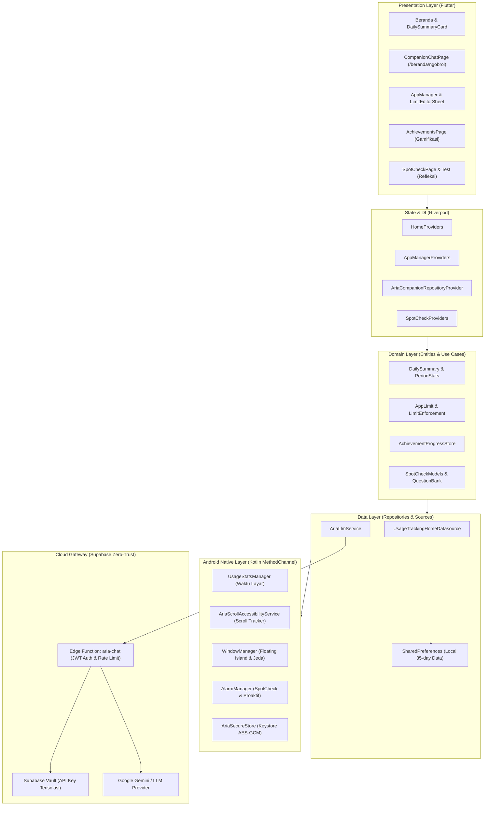
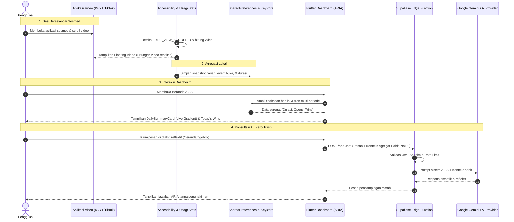

# ARIA — Mindful Digital Wellbeing Companion

<p align="center">
  <em>Mengubah dorongan scrolling tanpa sadar menjadi kesadaran penuh melalui pendampingan digital yang empatik, terukur, dan menghormati privasi.</em>
</p>

---

## 👥 Informasi Tim & Kompetisi

* **Kategori**: Mobile App — Digital Well-being
* **Nama Aplikasi**: **ARIA** *(Mindful Digital Wellbeing Companion)*
* **Nama Tim**: **Besok Maju Upacara**
* **Daftar Anggota**:
  1. **Muhammad Rasya Putra**
  2. **Athaya Mirza Calief**
  3. **Syahmirza Azka Ramadhan**

---

## 💡 Masalah, Solusi, & Target Pengguna

### 1. Masalah yang Diangkat (The Problem)
Di era media sosial modern (TikTok, Instagram Reels, YouTube Shorts), antarmuka dirancang dengan *frictionless infinite scroll* dan algoritma prediktif berbasis *variable reward schedule*. Mekanisme ini mengeksploitasi refleks dopamin manusia, memicu kondisi *trance* digital di mana pengguna kehilangan kendali waktu dan kesadaran (*dissociative scrolling* / *doomscrolling*).

Dampaknya nyata:
* Penurunan rentang atensi (*attention span*) dan fokus kerja/belajar.
* Kelelahan mental (*cognitive fatigue*) dan gangguan kecemasan (*FOMO*).
* Penurunan kualitas tidur serta produktivitas harian.

**Kelemahan App Blocker Konvensional**:  
Sebagian besar aplikasi pengontrol waktu layar bersandar pada **restriksi keras (punitive blocking)** seperti memblokir paksa dengan password atau mempermalukan pengguna (*guilt-tripping*). Pendekatan represif ini terbukti sering memicu resistensi pengguna (*reactance theory*): pengguna merasa dihakimi, kesal, lalu mencabut izin atau meng-uninstall aplikasi.

### 2. Solusi yang Ditawarkan (The Solution)
ARIA hadir bukan sebagai "penjara digital", melainkan sebagai **pendamping sadar (*mindful companion*)** yang memulihkan agensi pengguna melalui empat pilar:
1. **Mindful Friction (Friksi Berkesadaran)**: Menyisipkan jeda napas (*breathing pause*) dan pertanyaan reflektif saat pengguna membuka aplikasi sosial media atau saat kuota harian tercapai. Friksi beberapa detik ini mengaktifkan kembali korteks prafrontal (*prefrontal cortex*) agar pengguna membuat keputusan secara sadar.
2. **Penyadaran Waktu Nyata di Tempat (*On-The-Spot Awareness*)**: Melalui *Floating Island* non-intrusif di status bar yang menampilkan hitungan video yang telah digulir secara langsung di atas aplikasi target.
3. **Refleksi Empatik Tanpa Penghakiman**: ARIA menyapa dengan nada hangat (*gentle, firm, playful, scriptural*) dan merayakan langkah kecil (*Today's Wins*), bukan mencela durasi pemakaian.
4. **Gamifikasi Berbasis Usaha Positif**: Mengapresiasi kebiasaan baik seperti keluar dari aplikasi dalam 60 detik (*intentional exit*), menyelesaikan jeda napas, atau menurunkan durasi konsumsi harian.

### 3. Target Pengguna (Target Audience)
* **Pelajar & Mahasiswa**: Yang sering terjebak maraton scroll video di sela-sela waktu belajar atau menjelang tidur.
* **Pekerja Kreatif & Profesional Digital**: Yang membutuhkan pemeliharaan fokus tinggi (*deep work*) namun rentan terdistraksi media sosial saat membuka smartphone.
* **Gen Z & Milenial**: Pengguna aktif media sosial berbasis video pendek yang ingin mengontrol kebiasaan digital secara mandiri tanpa merasa dihakimi atau dikekang.

---

## 🚀 Fitur Utama yang Berhasil Diimplementasikan

| Fitur | Status | Deskripsi & Implementasi Teknis |
| :--- | :---: | :--- |
| **Floating Island (Hitungan Video Mengambang)** | ✅ **Selesai** | Overlay mengambang non-intrusif dan *non-touchable* di notification bar (`WindowManager`). Menghitung perkiraan konten video pendek yang digulir saat membuka Instagram, YouTube, dan TikTok secara *real-time*. Pada milestone tertentu (misal: 20 video), menampilkan pesan jeda singkat. |
| **Daily Summary Card (Live Animated Gradient)** | ✅ **Selesai** | Kartu headline utama beranda dengan latar belakang gradasi dinamis (*cyclic golden amber to warm cream*). Menampilkan ringkasan video digulir, screen time sosial, dan frekuensi buka aplikasi. |
| **Multi-Period Social Opens Trend** | ✅ **Selesai** | Analisis perbandingan frekuensi membuka media sosial dalam interval 1 Hari, 1 Minggu, dan 1 Bulan beserta rasio perubahan (*delta ratio*). |
| **Grafik Tren 7 Hari (Weekly Trend Chart)** | ✅ **Selesai** | Visualisasi grafik batang waktu pemakaian harian dibandingkan batas target harian pengguna. |
| **Kemenangan Hari Ini (Today's Wins)** | ✅ **Selesai** | Mesin aturan lokal yang secara otomatis memberikan lencana apresiasi saat pengguna berhasil mengurangi screen time, menjaga batas, atau menekan frekuensi buka. |
| **ARIA AI Companion & Konsultasi Dialog** | ✅ **Selesai** | Dialog reflektif interaktif (`/beranda/ngobrol`) berbasis AI empatik, didukung kartu pesan refleksi harian di beranda dan opsi pengingat proaktif terjadwal. |
| **Pengelola Aplikasi (App Manager)** | ✅ **Selesai** | Penyetelan kuota harian per aplikasi dengan 4 mode penegakan (*Track Only*, *Warn*, *Breathe* 15 detik, *Block*) serta opsi pengingat friksi 8 detik saat aplikasi baru dibuka. |
| **Level Journey & Gamifikasi (Pencapaian)** | ✅ **Selesai** | Pelacakan progres kebiasaan dalam 5 kategori bertingkat: *Self-control*, *Menjaga batas*, *Hari lebih ringan*, *Keluar dengan sadar*, dan *Menyelesaikan jeda napas*. |
| **Refleksi & Tes Fokus Spontan (Spot Check)** | ✅ **Selesai** | Evaluasi berkala yang memicu notifikasi tes fokus visual, memori kerja, dan rating perasaan pribadi dengan grafik riwayat tren emosional. |
| **Visual Permission Onboarding (3-Second Rule)** | ✅ **Selesai** | Antarmuka *first-launch onboarding* berbasis visual intuitif yang memandu perizinan sistem esensial secara bertahap tanpa teks bertele-tele. |

---

## 🛠️ Teknologi yang Digunakan

### 1. Client-Side (Mobile App)
* **Framework**: Flutter 3.24+ (Dart SDK `^3.13.7`)
* **Platform Native**: Android SDK (Kotlin, API Level 26–35 / Android 8.0 s/d 15)
* **State Management & Dependency Injection**: `flutter_riverpod` (^3.5.0)
* **Routing & Deep Linking**: `go_router` (^18.1.3)
* **Penyimpanan Lokal (Persistence)**:
  * `shared_preferences` (^2.5.3) untuk preferensi aplikasi dan snapshot agregat harian (retensi 35 hari).
  * `AriaSecureStore.kt` berbasis **Android Keystore hardware-backed encryption (AES-GCM 128-bit)** untuk menyimpan kredensial sesi anonim secara aman.
* **Pemodelan Data & Immutability**: `freezed_annotation`, `json_annotation`, `build_runner`
* **Formatting & Lokalisasi**: `intl`, `flutter_localizations`
* **Linting & Code Quality**: `flutter_lints`, `custom_lint` (dengan modul aturan privat `aria_lint`)

### 2. Native Android Integration (Low-Level APIs)
* **`AccessibilityService` (`AriaScrollAccessibilityService.kt`)**: Deteksi event gulir layar (`TYPE_VIEW_SCROLLED`) dan siklus hidup aplikasi video pendek target.
* **`WindowManager` (System Alert Window)**: Rendering overlay *Floating Island* dan kartu intervensi jeda napas di atas aplikasi lain.
* **`UsageStatsManager`**: Agregasi durasi waktu layar (*foreground time*) dan frekuensi peluncuran aplikasi (*app opens*).
* **`AlarmManager` & `BroadcastReceiver`**: Penjadwalan tes fokus berkala (*Spot Check*) dan notifikasi pengingat proaktif persisten pasca-reboot.

### 3. Backend & Cloud Infrastructure
* **BaaS / Serverless**: Supabase
* **Serverless Functions**: Supabase Edge Functions (Deno / TypeScript) untuk AI Zero-Trust Gateway.
* **Database & Vault**: Supabase PostgreSQL dengan integrasi `Supabase Vault` untuk menyimpan API Key LLM secara terisolasi dari aplikasi klien.
* **AI Engine**: Google Gemini API / OpenAI-compatible LLM endpoint yang diproxy melalui Edge Function aman.

---

## 🏗️ Arsitektur Sistem & Alur Data

### 1. Diagram Arsitektur (Clean Architecture & Feature-First)



---

### 2. Diagram Alur Data (Data Flow)



---

## ⚡ Panduan Instalasi & Aktivasi Izin

Bagi pengguna yang menginstal file APK rilis secara langsung (*sideload*), ikuti panduan berikut agar aplikasi terinstal dan seluruh fitur deteksi berfungsi optimal:

### 1. Melewati Peringatan Google Play Protect saat Install
Karena file APK diunduh langsung dari GitHub Releases (bukan dari Google Play Store), Play Protect akan memunculkan peringatan pemblokiran:
1. Saat pop-up peringatan Play Protect muncul, **jangan** tekan "Oke".
2. Ketuk **"Detail selengkapnya"** *(More details)*.
3. Ketuk **"Tetap instal"** *(Install anyway)*.
> *Catatan: ARIA murni beroperasi secara lokal untuk mengukur waktu layar dan scroll video Anda. Tidak ada data pribadi atau konten layar yang dikumpulkan.*

### 2. Membuka Kunci Izin Aksesibilitas di Android 13, 14, & 15 ("Setelan Dibatasi")
Android 13+ secara otomatis mengunci (*grayed out*) tombol Aksesibilitas untuk aplikasi yang dipasang di luar Play Store dengan pesan *"Setelan dibatasi" (Restricted setting)*:
1. Buka **Pengaturan HP (Settings)** ➔ **Aplikasi (Apps)** ➔ cari dan pilih **ARIA**.
2. Di halaman **Info Aplikasi (App Info)** tersebut, lihat **pojok kanan atas** lalu ketuk **ikon titik tiga (⋮)**.
3. Pilih menu **"Izinkan setelan terbatas"** *(Allow restricted settings)*, lalu konfirmasi dengan PIN, Pola, atau Sidik Jari HP Anda.
4. Buka kembali aplikasi ARIA atau masuk ke menu **Aksesibilitas** HP ➔ **Aplikasi yang didownload** ➔ pilih **ARIA pelacak scroll** ➔ aktifkan toggle izin.

---

## 🔒 Daftar Izin Sistem (Permissions) & Justifikasi

| Izin Android | Kategori | Alasan & Fungsi |
| :--- | :--- | :--- |
| `android.permission.PACKAGE_USAGE_STATS` | *Special Access* | Membaca total waktu pemakaian harian dan frekuensi membuka aplikasi sosial media melalui Android `UsageStatsManager`. |
| `android.permission.SYSTEM_ALERT_WINDOW` | *Special Access* | Menampilkan *Floating Island* (indikator jumlah scroll) dan kartu jeda napas (*intervention pause card*) mengambang di atas aplikasi target. |
| `android.permission.BIND_ACCESSIBILITY_SERVICE` | *Accessibility* | Mendeteksi event gulir layar (`TYPE_VIEW_SCROLLED`) di aplikasi media sosial yang didukung guna memperkirakan jumlah konten yang telah di-scroll. |
| `android.permission.POST_NOTIFICATIONS` | *Runtime (Android 13+)* | Mengirimkan notifikasi peringatan kuota aplikasi, pengingat refleksi berkala (Spot Check), dan pesan pendampingan proaktif. |
| `android.permission.RECEIVE_BOOT_COMPLETED` | *Normal* | Menjadwalkan ulang alarm pengingat refleksi mingguan dan pengingat proaktif setelah perangkat di-restart (*reboot*). |
| `android.permission.INTERNET` | *Normal* | Menghubungkan aplikasi ke Supabase Edge Function untuk fitur dialog AI Companion (jika pengguna mengaktifkan fitur AI). |
| `android.permission.REQUEST_IGNORE_BATTERY_OPTIMIZATIONS` | *Special Access* | Menjaga agar penjadwalan alarm refleksi dan layanan pengingat latar belakang tidak dibunuh secara agresif oleh sistem manajemen daya perangkat. |

---

## 🤖 Dokumentasi Penggunaan AI (ARIA AI Companion)

### 1. Peran AI dalam Aplikasi
AI pada ARIA berfungsi sebagai **penasihat digital yang empatik dan suportif**, bukan pengambil keputusan otomatis atau sistem penilai moral. AI bertugas:
* Memberikan pesan reflektif harian di kartu beranda berdasarkan tren penggunaan (apresiasi saat waktu layar turun, dukungan ramah saat waktu layar naik).
* Menjadi rekan dialog di halaman `/beranda/ngobrol` untuk berdiskusi santai mengenai kecemasan digital, pemicu scrolling, dan strategi jeda napas.
* Menghasilkan pesan notifikasi proaktif yang personal dan menenangkan.

### 2. Arsitektur AI Zero-Trust Gateway
Untuk menjamin keamanan dan kerahasiaan:
* **Tidak Ada API Key di Aplikasi Klien**: File APK ARIA **sama sekali tidak menyimpan API key** provider AI (Google Gemini / OpenAI). 
* **Otentikasi Anonim via Supabase**: Klien berkomunikasi dengan endpoint Supabase Edge Function (`aria-chat`) menggunakan token sesi JWT anonim yang disimpan di hardware Android Keystore.
* **Isolasi Database Vault**: API key LLM disimpan di dalam `Supabase Vault` di sisi server.
* **Rate Limiting**: Pemanggilan AI dibatasi secara terpusat (maksimal 20 permintaan per jendela waktu) melalui fungsi SQL `consume_aria_request_limit` untuk mencegah penyalahgunaan kuota.

### 3. Perlindungan Privasi (Zero PII & Data Minimization)
Data yang dikirimkan ke model AI **hanya** berupa:
* Teks pertanyaan yang diketik pengguna di kolom chat.
* Ringkasan agregat kebiasaan anonim (contoh: *"Rata-rata 45 menit/hari, tren menurun 15%"*).
* Pilihan nada komunikasi yang diinginkan pengguna (*lembut, tegas, santai, atau reflektif*).

> [!IMPORTANT]
> ARIA **tidak pernah** mengirimkan teks ketikan layar, pesan pribadi, konten postingan video, daftar seluruh aplikasi pengguna, atau identitas pribadi (*No PII*) ke model AI.

### 4. Mode Mandiri (Local Offline Fallback)
Jika koneksi internet mati atau gateway AI belum dikonfigurasi, ARIA tetap berfungsi 100% normal. Mesin aturan lokal (`TodaysWinGenerator` dan `AriaMessage`) otomatis mengambil alih untuk memproduksi apresiasi dan analisis tren berbasis logika matematis internal tanpa memerlukan koneksi server.

---

## 💻 Panduan Menjalankan & Membangun dari Source Code

### Prasyarat Pengembangan
* **Flutter SDK**: Versi `3.24.0` atau yang lebih baru.
* **Dart SDK**: Versi `^3.13.7`.
* **Android SDK**: Compile SDK 34 / 35, Min SDK 24 (disarankan Min SDK 26).
* **Perangkat Fisik Android**: Sangat disarankan perangkat fisik asli untuk menguji *Accessibility Service*, *UsageStats*, dan overlay *Floating Island*.

### 1. Kloning Repositori & Instal Dependensi
```bash
git clone https://github.com/Syacretary/aria.git
cd aria
flutter pub get
```

### 2. Konfigurasi Variabel Lingkungan (`.env`)
Salin berkas konfigurasi template:
```bash
cp .env.example .env
```
Buka file `.env` dan sesuaikan nilainya:
```ini
# URL Proyek Supabase
ARIA_SUPABASE_URL=https://YOUR_PROJECT_REF.supabase.co

# Kunci Anonim Publik Supabase
ARIA_SUPABASE_ANON_KEY=YOUR_SUPABASE_PUBLISHABLE_OR_ANON_KEY
```

### 3. Konfigurasi Release Keystore (Opsional untuk Rilis Resmi)
Untuk menandatangani APK rilis menggunakan sertifikat pribadi:
1. Buat berkas `android/key.properties`:
   ```ini
   storePassword=password_keystore_anda
   keyPassword=password_key_anda
   keyAlias=aria
   storeFile=key.jks
   ```
2. Letakkan berkas sertifikat `key.jks` di dalam direktori `android/`.

### 4. Menjalankan Mode Debug di Perangkat
```bash
flutter run
```

### 5. Membangun APK Rilis
```bash
flutter build apk --release --dart-define-from-file=.env
```
File APK siap instal akan berada di `build/app/outputs/flutter-apk/app-release.apk`.

---

## 📜 Atribusi, Aset, & Lisensi Pihak Ketiga

Proyek ARIA dibangun dengan memanfaatkan pustaka dan aset berlisensi terbuka berikut:

* **Tipografi**:
  * **Plus Jakarta Sans** oleh Gumpita Rahayu / Tokotype. Dilisensikan di bawah [SIL Open Font License 1.1](file:///home/syacretary/Projects/mobileapp/ARIA/assets/fonts/PlusJakartaSans-LICENSE.txt). Aset font disematkan langsung di dalam repositori (`assets/fonts/`) agar rendering deterministik tanpa ketergantungan koneksi internet.
* **Ikonografi & Visual**:
  * **Cupertino Icons & Material Design Icons** oleh Google / Flutter Team.
  * **Aset Tutorial Izin**: Tangkapan layar panduan visual izin (`assets/permissions/`) diproduksi secara orisinal oleh tim pengembang ARIA.
  * **App Icon Adaptif**: Dihasilkan dan diolah secara orisinal menjadi aset Android Adaptive Icon (`mipmap-*/ic_launcher`).
* **Pustaka Open Source**:
  * `flutter_riverpod` (MIT License) oleh Remi Rousselet.
  * `go_router` (BSD-3-Clause) oleh Flutter Team.
  * `freezed` & `json_serializable` (MIT License).
  * `shared_preferences` (BSD-3-Clause).
  * `supabase-js` (MIT License).

---

<p align="center">
  Dibuat dengan kesadaran penuh oleh <strong>Tim Besok Maju Upacara</strong> © 2026.
</p>
